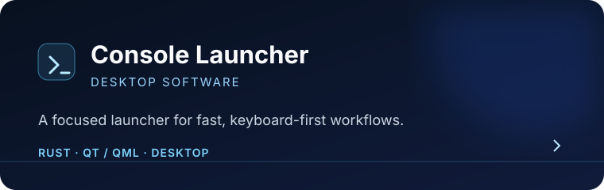
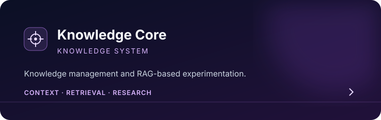
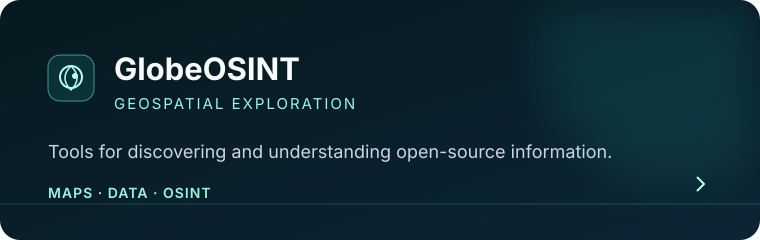
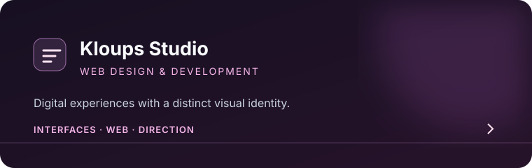

  <strong>Independent developer · designer · creative technologist</strong> 
  Building useful digital experiences where software, visual craft and reliable infrastructure meet.

<a href="https://kloups.fr">Portfolio</a>
&nbsp;&nbsp;·&nbsp;&nbsp;
<a href="https://github.com/walou444">GitHub</a>
&nbsp;&nbsp;·&nbsp;&nbsp;
<a href="https://github.com/walou444?tab=repositories">Repositories</a>

 

## / about

<table>
  <tr>
    <td width="58%" valign="top">
      
<strong>I make technology feel considered.</strong>

      
From Rust desktop software to self-hosted web infrastructure, I work across the full path from first sketch to dependable release. Kloups Studio is the space where those products, experiments and visual ideas come together.

      
Based in Rennes, France · available for thoughtful digital work

    </td>
    <td width="42%" valign="top">
      <pre><code>const walou = {
  studio: "Kloups",
  focus: ["software", "design", "infra"],
  mode: "build with intent",
};</code></pre>

    </td>
  </tr>
</table>

 

## / selected work

  
  
   
  
  

 

## / technology ecosystem

<table>
  <tr>
    <td width="50%" valign="top">
      <strong>Languages</strong> 
      Systems, interfaces and data work  
      
    </td>
    <td width="50%" valign="top">
      <strong>Web development</strong> 
      Product surfaces and interactive experiences  
      
    </td>
  </tr>
  <tr>
    <td width="50%" valign="top">
      <strong>Desktop applications</strong> 
      Focused tools with native-feeling interaction  
      
       Qt · QML · Rust
    </td>
    <td width="50%" valign="top">
      <strong>Infrastructure &amp; DevOps</strong> 
      Repeatable, observable and self-hosted systems  
      
    </td>
  </tr>
  <tr>
    <td colspan="2" valign="top">
      <strong>Creative tools</strong> 
      Interface design · motion · audiovisual production · creative coding
    </td>
  </tr>
</table>

 

## / github, in motion

  
  

  

  

  Analytics are optional views of public GitHub data. If a provider is unavailable, the linked profile remains the source of truth.

 

## / connect

**[kloups.fr](https://kloups.fr)** &nbsp;·&nbsp; **[github.com/walou444](https://github.com/walou444)**

  

Made with intention from Rennes, France · Kloups Studio

