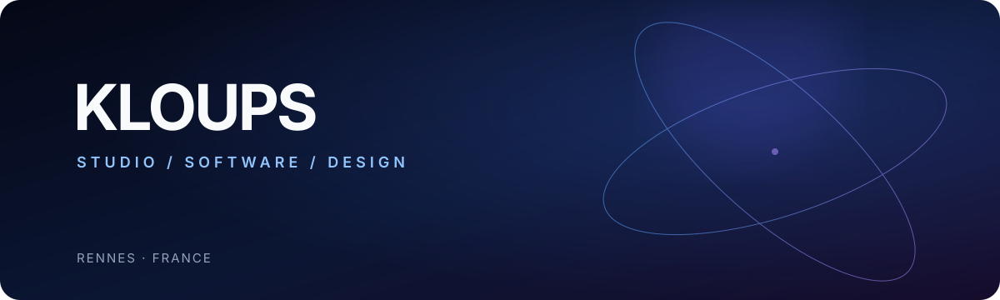

<div align="center">

<a href="https://kloups.fr">
  
</a>

<p>
  <strong>Independent developer · designer · creative technologist</strong><br>
  Building useful digital experiences where software, visual craft and infrastructure meet.
</p>

<a href="https://kloups.fr">Portfolio</a>
&nbsp;&nbsp;·&nbsp;&nbsp;
<a href="https://github.com/walou444">GitHub</a>
&nbsp;&nbsp;·&nbsp;&nbsp;
<a href="https://github.com/walou444?tab=repositories">Projects</a>

</div>

<br>

## About

```text
┌─ kloups@rennes ───────────────────────────────────────────────┐
│                                                                │
│  I design and build calm, purposeful tools.                   │
│  From Rust desktop software to self-hosted web infrastructure, │
│  I care about the details that make technology feel human.     │
│                                                                │
│  / software development   / web design & integration           │
│  / audiovisual production / Linux infrastructure               │
│  / self-hosting & automation / creative technology              │
│                                                                │
└────────────────────────────────────────────────────────────────┘
```

Based in **Rennes, France**, I work across the full path from first sketch to
reliable deployment. **Kloups Studio** is the space where those experiments,
products and visual ideas come together.

## Selected work

<table>
  <tr>
    <td width="50%" valign="top">
      <h3>Console Launcher</h3>
      <p>A focused desktop launcher for fast, keyboard-first workflows.</p>
      <sub><strong>Rust</strong> · <strong>Qt/QML</strong> · Desktop</sub>
    </td>
    <td width="50%" valign="top">
      <h3>Knowledge Core</h3>
      <p>Knowledge management and RAG-based experimentation for turning information into context.</p>
      <sub><strong>Python</strong> · RAG · Research</sub>
    </td>
  </tr>
  <tr>
    <td width="50%" valign="top">
      <h3>GlobeOSINT</h3>
      <p>Geospatial exploration tools for discovering and understanding open-source information.</p>
      <sub><strong>TypeScript</strong> · Maps · Data exploration</sub>
    </td>
    <td width="50%" valign="top">
      <h3>Kloups Studio</h3>
      <p>A design and development portfolio for digital experiences with a distinct visual identity.</p>
      <sub><strong>Next.js</strong> · <strong>React</strong> · Web design</sub>
    </td>
  </tr>
</table>

## Toolbox

<p>
  <strong>Languages</strong><br>
  
</p>

<p>
  <strong>Frontend & desktop</strong><br>
  
</p>

<p>
  <strong>Infrastructure</strong><br>
  
</p>

<p>
  <strong>Design & creative tools</strong><br>
  Audiovisual production · interface design · motion · creative coding
</p>

## GitHub, in motion

<div align="center">
  <a href="https://github.com/walou444">
    
  </a>
  <a href="https://github.com/walou444">
    
  </a>
</div>

<p align="center">
  <a href="https://github.com/walou444">
    
  </a>
</p>

<p align="center">
  <sub>If an analytics image is unavailable, the linked GitHub profile remains the source of truth.</sub>
</p>

## Connect

<div align="center">

**[kloups.fr](https://kloups.fr)** &nbsp;·&nbsp; **[github.com/walou444](https://github.com/walou444)**

<br><br>

<sub>Made with intention from Rennes, France · Kloups Studio</sub>

</div>
